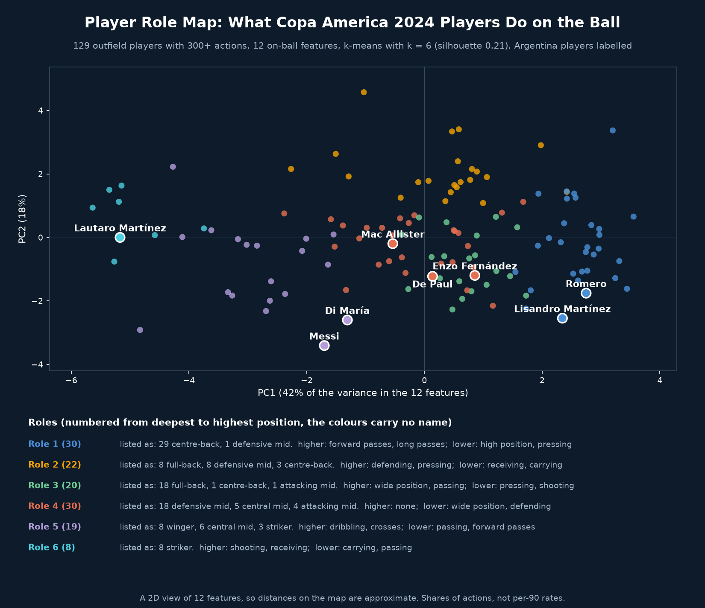
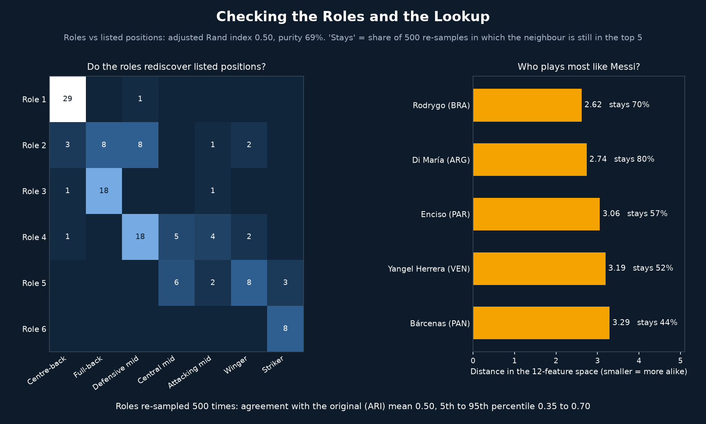

# Player Role Finder

## Why
Positions on a team sheet are labels, not measurements. This project describes what each outfield regular at Copa America 2024 actually does on the ball, groups players into roles, checks the roles against their listed positions, and asks who plays like whom.

## What it does
- Keeps 129 outfield players with 300+ actions (about 3 full matches), 69,070 actions in total, 2 to 6 matches each. Goalkeepers are left out
- Describes each player with 12 features, all shares of his own actions or positions: passing, carrying, dribbling, shooting, pressing, defending, receiving, average position, wideness, long passes, forward passes and crosses. There are no minutes in the data, so these describe a role, not quality
- Groups players with k-means (PCA, k-means, silhouette score and adjusted Rand index written in NumPy), choosing k from 3 to 8 by silhouette score
- Checks the roles against listed positions (7 groups) with the adjusted Rand index (ARI) and purity
- Finds each player's 5 closest players by distance in the 12-feature space
- Re-samples each player's matches 500 times, re-groups the players and recomputes the neighbours, to show how reliable the roles and lookups are
- Replays the lookup for 6 Argentina players, neighbour by neighbour

## Key findings

| Role | Players | Listed as | Higher | Lower |
|---|---|---|---|---|
| 1 | 30 | 29 centre-back, 1 defensive mid | forward passes, long passes | high position, pressing |
| 2 | 22 | 8 full-back, 8 defensive mid, 3 centre-back | defending, pressing | receiving, carrying |
| 3 | 20 | 18 full-back, 1 centre-back, 1 attacking mid | wide position, passing | pressing, shooting |
| 4 | 30 | 18 defensive mid, 5 central mid, 4 attacking mid | none | wide position, defending |
| 5 | 19 | 8 winger, 6 central mid, 3 striker | dribbling, crosses | passing, forward passes |
| 6 | 8 | 8 striker | shooting, receiving | carrying, passing |

| Check | Result |
|---|---|
| Variance on PC1 and PC2 | 42% and 18% |
| Silhouette by k | k=3: 0.188, k=4: 0.192, k=5: 0.203, k=6: 0.213, k=7: 0.186, k=8: 0.197 |
| Roles vs listed positions | ARI 0.50, purity 69% |
| Roles re-sampled 500 times, agreement with the original | ARI mean 0.50, 5th to 95th 0.35 to 0.70 |

| Player (team) | Closest 5 (distance) | Avg stays in top 5 |
|---|---|---|
| Messi (ARG) | Rodrygo 2.62, Di María 2.74, Enciso 3.06, Yangel Herrera 3.19, Bárcenas 3.29 | 61% |
| Enzo Fernández (ARG) | Bruno Guimarães 0.97, Koné 1.43, Lo Celso 1.73, Paredes 1.74, Cuesta 1.83 | 51% |
| De Paul (ARG) | Lo Celso 1.25, Tagliafico 1.71, Eustáquio 1.85, Bruno Guimarães 1.89, Yangel Herrera 1.89 | 49% |
| Romero (ARG) | Lichnovsky 1.17, Lisandro Martínez 1.23, Ream 1.45, Cuesta 1.52, Marquinhos 1.59 | 56% |
| Di María (ARG) | Murillo 2.27, Raphinha 2.33, Quiñones 2.62, Bárcenas 2.69, Messi 2.74 | 50% |
| Lautaro Martínez (ARG) | Fajardo 2.76, Núñez 3.03, Larin 3.04, Rondón 3.14, Jhon Córdoba 3.36 | 77% |
| Mac Allister (ARG) | Villamíl 1.37, J. Osorio 1.42, Bruno Guimarães 1.48, Eustáquio 1.51, Lo Celso 1.52 | 50% |
| Lisandro Martínez (ARG) | Romero 1.23, Paredes 1.56, Lichnovsky 1.57, Cuesta 1.75, Richards 1.87 | 64% |

- The roles recover some positions well: Role 1 is 29 of 30 centre-backs, Role 6 is 8 strikers and Role 3 is 18 full-backs out of 20 players. Midfielders and wingers are mixed across roles (ARI 0.50, purity 69%)
- The structure is weak: every k from 3 to 8 scored a silhouette of only 0.19 to 0.21, so k=6 was chosen by a hair and the players look like a continuous cloud, not separate roles
- The roles are only partly stable: re-sampling each player's matches gives agreement of 0.50 (0.35 to 0.70)
- Attackers have far neighbours: Messi's five closest are at 2.6 to 3.3, Lautaro Martínez's at 2.8 to 3.4 and Di María's at 2.3 to 2.7, while Romero's are at 1.2 to 1.6 and Enzo Fernández's closest, Bruno Guimarães, is at 0.97. A far neighbour means nothing is close, not that the player has a lookalike. Messi's list includes a defensive midfielder (Yangel Herrera, 3.19) for that reason
- The lookups differ in reliability: Lautaro's neighbours (all strikers) stay in the top 5 in 77% of re-samples on average, Lisandro Martínez's in 64%, Messi's in 61%, De Paul's in 49%
- Team context did not dominate: only 10 of the 40 neighbours were team-mates
- Listed position is not role: Leandro Paredes is listed as a defensive midfielder but his role is with the centre-backs, and he is Lisandro Martínez's second-closest match

## Limitations
- No minutes in the data, so a player with few actions has noisy shares. 300 actions is about 3 full matches
- Features are partly shaped by the team's style and the opponents, which was not removed
- Listed positions are the most common position in the data, not a ground truth (for example Messi is listed as a striker and Di María as a central midfielder)
- The roles are not named: a role is a summary of the 12 features, and different features can give different roles
- Distances differ by region: attackers sit in a sparse area, so their nearest neighbours are always further away
- A close neighbour means a similar action mix, not a similar level of quality
- The map is a 2D view of 12 features, so distances on it are approximate

## Visual

*129 players on the first two principal components, coloured by role. Argentina players are labelled.*

*Left: how many players of each listed position fall in each role. Right: Messi's five closest players, with the share of re-samples in which each stays in the top 5.*

`player_role_replay.mp4` replays the lookup for 6 Argentina players and ends with both charts.

## Tools
Python, pandas, NumPy, matplotlib, imageio-ffmpeg. PCA, k-means, silhouette score and adjusted Rand index are written in NumPy.

## Data source
StatsBomb open data, Copa America 2024 (32 matches). Outfield players with 300+ actions.
